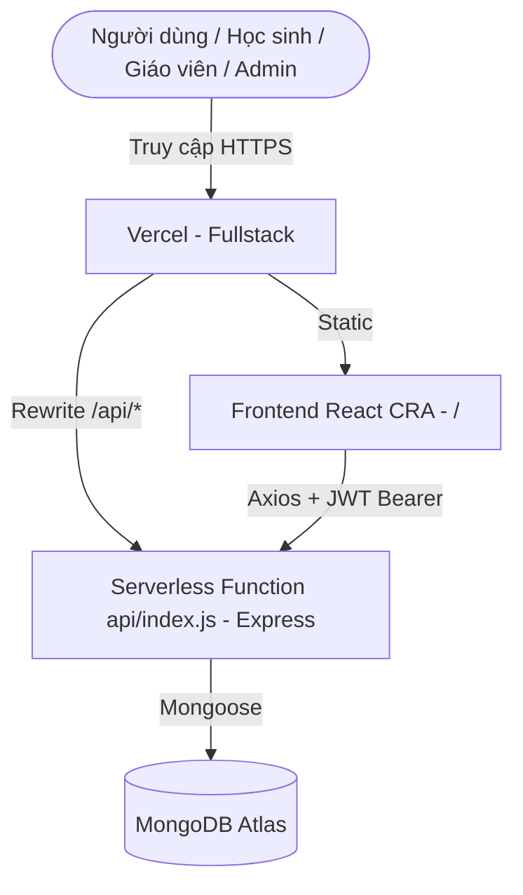

# EKLASSES - NỀN TẢNG QUẢN LÝ LỚP HỌC TRỰC TUYẾN (TUTORING PLATFORM)

Chào mừng bạn đến với **EKLASSES** - nền tảng quản lý lớp học trực tuyến cho giáo viên tự do và gia sư, tích hợp đầy đủ **lớp học, video bài giảng, tài liệu, bài kiểm tra trắc nghiệm, bài tập và thông báo** trong một hệ thống duy nhất với 3 phân quyền **Admin / Giáo viên / Học sinh**.

Tài liệu kỹ thuật và hướng dẫn liên quan được tập trung tại [docs/README.md](docs/README.md).

---

## 0. LIÊN KẾT WEBSITE (WEBSITE LINKS)

| Môi trường | Địa chỉ | Ghi chú |
|------------|---------|---------|
| Production (Vercel) | `https://<domain-cua-ban>.vercel.app` | Frontend + API fullstack chung 1 domain (thay `<domain-cua-ban>` bằng domain thật sau khi deploy) |
| Health check (production) | `https://<domain-cua-ban>.vercel.app/api/health` | Phải trả về `{"status":"ok"}` thì backend mới sống |
| API docs (production) | `https://<domain-cua-ban>.vercel.app/api/docs` | Danh sách endpoint rút gọn |
| Local frontend | `http://localhost:3000` | Chạy bằng `npm start --prefix frontend` |
| Local backend | `http://localhost:5000` | Chạy bằng `npm run dev --prefix backend` |
| Health check (local) | `http://localhost:5000/api/health` | Phải trả về `{"status":"ok"}` |

---

## 0.1. TÀI KHOẢN QUẢN TRỊ

Không có mật khẩu admin mặc định hoặc bypass bằng biến môi trường. Mọi tài khoản đăng nhập bằng mật khẩu đã hash trong MongoDB và phải đáp ứng kiểm tra trạng thái tài khoản.

Admin mới được tạo thủ công qua `npm run seed:admin --prefix backend` với `MONGODB_URI`, `ADMIN_EMAIL`, `ADMIN_PASSWORD` tường minh (mật khẩu ngẫu nhiên ít nhất 16 ký tự, tối đa 72 byte UTF-8). Lệnh chỉ tạo mới, không reset/mở khóa/nâng quyền tài khoản đã tồn tại. Kết nối DB không tự bootstrap.

Danh tính gốc `admin@eklasses.vn` vẫn được bảo vệ khỏi đăng ký public, xóa/hạ quyền, nhưng không được bỏ qua kiểm tra mật khẩu/trạng thái. Admin có thể đổi mật khẩu tại hồ sơ.

**Môi trường cũ phải xoay vòng mật khẩu từng công khai và đánh giá thu hồi phiên**; chỉ cập nhật code không thay hash cũ hoặc token đã cấp. Xem quy trình và checklist vận hành trong [docs/ADMIN_BOOTSTRAP.md](docs/ADMIN_BOOTSTRAP.md).

---

## 1. KIẾN TRÚC HỆ THỐNG (SYSTEM ARCHITECTURE)

Hệ thống chạy theo mô hình **Client-Server**, deploy fullstack trên cùng một domain Vercel (frontend + serverless API), dữ liệu lưu trên MongoDB Atlas.



### 1.1. Công nghệ Frontend (Create React App)
* **Framework chính:** React 18 + React Router v6 (SPA, phân route `/login`, `/register`, `/dashboard`, `/class/:id`, `/quiz/:quizId/take`).
* **Gọi API:** Axios tập trung tại `src/config/api.js` — tự đọc `REACT_APP_API_URL`, tự gắn `Authorization: Bearer <token>` cho mọi request.
* **Bài giảng video:** `react-player` phát video theo URL.
* **Thống kê:** `recharts` vẽ biểu đồ (điểm số, tiến độ học tập).
* **Styling:** 1 file CSS duy nhất `src/styles/App.css` + style inline theo component; giao diện tiếng Việt, thương hiệu EKLASSES.

### 1.2. Công nghệ Backend & Database
* **Runtime Environment:** Node.js v18+ kết hợp Express framework (`backend/server.js`, export `app` để vừa chạy local `node server.js` vừa chạy serverless trên Vercel qua `api/index.js`).
* **Cơ sở dữ liệu:** MongoDB (Mongoose v7), lưu trên MongoDB Atlas khi deploy, Mongo local khi dev.
* **Kết nối serverless:** Cache connection `global.mongoose` + middleware đảm bảo `connectDB()` trước mọi request `/api/*` (chống cold-start fail).
* **Bảo mật & Mã hóa:** Xác thực JWT (Bearer token, hết hạn 7 ngày) qua `authMiddleware`; phân quyền `teacherOnly` (giáo viên + admin) và `adminOnly`; mật khẩu hash bằng bcryptjs (pre-save hook + `comparePassword`).
* **Tài liệu/Video:** Lưu theo URL (`fileUrl`, `videoUrl`) do client cung cấp, backend chỉ lưu metadata (không upload file trực tiếp).

---

## 2. CÁC TÍNH NĂNG CHÍNH (KEY FEATURES)

### 2.1. Xác thực & Phân quyền (`/login`, `/register`)
* Đăng ký 2 vai trò public: **Học sinh / Giáo viên** (đăng ký `admin` và email admin gốc bị chặn ở backend).
* Đăng nhập trả về JWT + `{ id, name, email, role }`, lưu `token/userId/userRole` vào localStorage.
* Admin dùng mật khẩu/trạng thái trong DB như mọi role; không có nhánh đăng nhập ưu tiên từ cấu hình.
* `ADMIN_EMAIL` + `ADMIN_PASSWORD` (tùy chọn `ADMIN_NAME`) chỉ dùng cho bootstrap thủ công; không ghi đè mật khẩu đã đổi.
* Tạo admin mới: `npm run seed:admin --prefix backend` với cấu hình tường minh theo mục 0.1; email đã tồn tại sẽ bị từ chối, không khôi phục tự động.

### 2.2. Dashboard (`/dashboard`)
* Giáo viên: xem lớp mình dạy + tạo lớp mới (tên, mô tả, môn, khối).
* Học sinh: xem các lớp đã tham gia.
* Admin: xem **tất cả** lớp + tạo lớp như giáo viên.

### 2.3. Chi tiết lớp học (`/class/:id`)
* 5 tab: Tổng quan, Video, Tài liệu, Kiểm tra, Bài tập + Thông báo.
* Giáo viên: thêm học sinh bằng email (`POST /api/classes/:id/enroll`), đăng thông báo theo độ ưu tiên (`low/normal/high`).
* Học sinh: xem nội dung, nộp bài.

### 2.4. Làm bài kiểm tra (`/quiz/:quizId/take`) — chống gian lận
* Đếm ngược `timeLimit` (phút), hết giờ tự nộp.
* Phát hiện chuyển tab (`visibilitychange`) và cảnh báo.
* Hỗ trợ 3 dạng câu hỏi: trắc nghiệm (`multiple-choice`), tự luận (`essay`), trả lời ngắn (`short-answer`); chấm điểm + lưu lịch sử nộp bài.

### 2.5. Quản lý nội dung (Giáo viên)
* **Video:** thêm video theo URL + thumbnail, đếm lượt xem theo học sinh (`POST /api/videos/:id/view`).
* **Tài liệu:** thêm tài liệu theo URL + loại/dung lượng file, đếm lượt tải (`POST /api/documents/:id/download`).
* **Bài tập:** giao bài có hạn nộp + tổng điểm, học sinh nộp file URL, giáo viên chấm điểm + feedback.
* Tab **Bài tập** có khung nộp/xem kết quả chính chủ và chấm bài cho giáo viên phụ trách/admin; danh sách chỉ tải metadata. URL chỉ nhận HTTP(S), điểm trong thang của bài; xem [contract và kiểm thử #29](docs/BACKEND_SECURITY.md).
* **Thông báo:** đăng thông báo theo lớp, theo dõi ai đã đọc (`readBy`).

### 2.6. Quyền riêng tư hồ sơ — BE #01 / BE #02 ([#22](https://github.com/ThanhVu6102/tutoring-platform/issues/22), [#23](https://github.com/ThanhVu6102/tutoring-platform/issues/23))

Dữ liệu hồ sơ được lọc **ở backend trước khi gửi response**, không chỉ ẩn trên giao diện:

| Người xem | Dữ liệu hồ sơ được nhận |
|-----------|-------------------------|
| Người khác đã đăng nhập | ID (`_id`/`id`), tên, vai trò, avatar và bio nếu có trong dữ liệu nguồn |
| Chính chủ | Giữ thông tin hiện có của mình, gồm email, số điện thoại, lớp, trạng thái và thông tin xét duyệt, theo danh sách trường cho phép (allowlist) |
| Admin | Giữ thông tin quản trị hiện có theo allowlist, gồm email và thông tin xét duyệt |

* Không trả `password`, `scheduleRevision` hay trường mới chưa được cho phép, kể cả cho admin.
* BE #02 giữ chính sách BE #01 theo xác nhận của chủ dự án, không mở quyền xem email người khác theo mô tả `name`/`email` ban đầu của issue. Query hồ sơ theo ID chỉ lấy bộ trường công khai nếu người xem không phải chính chủ/admin; DTO vẫn lọc lại response và giới hạn trường lồng trong `review`.
* Quy tắc áp dụng cả hồ sơ trực tiếp và hồ sơ lồng trong lớp học, yêu cầu tham gia, video, tài liệu, thông báo, bài tập, bài kiểm tra/bài nộp và cảnh báo học sinh.
* Giáo viên không nhận email của học sinh qua các response trên. Giao diện lớp học chỉ hiển thị email trong yêu cầu tham gia và danh sách học sinh cho admin.
* Chức năng thêm học sinh bằng email đã biết vẫn giữ nguyên; không bổ sung điều kiện cùng lớp khi xem hồ sơ công khai.
* Chi tiết chức năng các đoạn code thay đổi: [docs/USER_PRIVACY.md](docs/USER_PRIVACY.md).
* Phạm vi BE #01 không xử lý tài khoản admin mặc định hoặc khóa JWT dự phòng; đây là các vấn đề bảo mật riêng, không nên coi bản sửa này là đã bảo đảm an toàn toàn hệ thống.

---

## 2.7. Hiệu năng tải dữ liệu — BE #04 ([issue #11](https://github.com/ThanhVu6102/tutoring-platform/issues/11))

* Danh sách lớp, user (admin), video, tài liệu, thông báo, bài tập và quiz luôn trả `{ data, page, limit, total, totalPages }`: mặc định 20, tối đa 100 bản ghi/trang. **Đây là thay đổi contract**, frontend/client cũ nhận mảng phải được cập nhật cùng backend.
* Danh sách lớp trả `studentCount`/`joinRequestCount` thay vì populate roster; danh sách quiz trả `questionCount`/`hasPromptImage`, không tải đề/ảnh base64. Endpoint chi tiết giữ chức năng hiện có.
* Dashboard phân trang; chi tiết lớp tải học liệu theo tab và lấy tổng qua `GET /api/classes/:id/content-summary`. Các route nặng được lazy-load.
* Kết nối MongoDB dùng chung promise trong mỗi instance, không tự tạo/khôi phục tài khoản admin. API riêng tư không cache ở CDN; có `Server-Timing` và logging timing tùy chọn.
* Công cụ và giới hạn: [docs/PERFORMANCE.md](docs/PERFORMANCE.md), [bằng chứng nghiệm thu](docs/PERFORMANCE.md#ket-qua). BE #04 đã được chủ dự án nghiệm thu Done; số đo dùng MongoDB Docker/dữ liệu giả, không phải cam kết hiệu năng production. Kiểm duyệt phân trang theo tab; một số lịch sử/thông báo vẫn đọc nhiều trang.

---

## 2.8. Kháng cáo — BE #03 ([issue #24](https://github.com/ThanhVu6102/tutoring-platform/issues/24))

* Học sinh gửi kháng cáo cảnh báo trong 7 ngày; giáo viên phụ trách gửi kháng cáo thông báo khóa lớp trong 24 giờ. Admin xét duyệt và lưu người xử lý/thời điểm/phản hồi.
* Quyết định và lịch sử chống ghi đè khi thao tác đồng thời. Xác nhận cảnh báo, gỡ khỏi lớp và cập nhật chế tài cùng transaction, cần MongoDB Atlas hoặc replica set.
* Học sinh chỉ xem cảnh báo của chính mình; hồ sơ kháng cáo khóa lớp dành cho giáo viên phụ trách/admin. Mở lớp giữ quyết định khóa ban đầu trong lịch sử.
* Contract, dữ liệu cũ và kiểm thử MongoDB thật: [docs/APPEALS.md](docs/APPEALS.md).

---

## 3. SƠ ĐỒ CƠ SỞ DỮ LIỆU (DATABASE SCHEMA)

MongoDB gồm 8 collections chính:

### Collection `users` (Học sinh, Giáo viên, Admin)
* `_id` (ObjectId, Khóa chính)
* `name` (String, bắt buộc)
* `email` (String, bắt buộc, unique)
* `password` (String, bắt buộc, hash bcrypt)
* `role` (String, enum `student`/`teacher`/`admin`, bắt buộc)
* `avatar` (String, mặc định null) / `bio` (String) / `phone` (String)
* `enrolledClasses` ([ObjectId ref `Class`])
* `createdAt` / `updatedAt` (Date)

### Collection `classes` (Lớp học)
* `_id` / `name` (String, bắt buộc) / `description` (String)
* `teacher` (ObjectId ref `User`, bắt buộc)
* `students` ([ObjectId ref `User`])
* `subject` (String, bắt buộc) / `grade` (String) / `capacity` (Number, mặc định 50)
* `schedule` ({ `dayOfWeek`, `startTime`, `endTime` }) / `thumbnail` (String)
* `status` (enum `active`/`inactive`, mặc định `active`)

### Collection `quizzes` (Bài kiểm tra, nhúng `questions`)
* `_id` / `title` (bắt buộc) / `description`
* `class` (ref `Class`, bắt buộc) / `teacher` (ref `User`, bắt buộc)
* `questions[]`: { `type` (enum `multiple-choice`/`essay`/`short-answer`), `question`, `options[]`, `correctAnswer`, `points` }
* `totalPoints` / `timeLimit` (phút) / `dueDate` / `allowReview` / `shuffleQuestions`
* `status` (enum `draft`/`published`/`closed`)

### Collection `quizsubmissions` (Bài nộp)
* `quiz` (ref `Quiz`) / `student` (ref `User`) / `class` (ref `Class`)
* `answers[]` / `score` / `submittedAt`

### Collection `assignments` (Bài tập, nhúng `submissions`)
* `_id` / `title` (bắt buộc) / `description`
* `class` (ref `Class`) / `teacher` (ref `User`)
* `dueDate` (bắt buộc) / `totalPoints` (mặc định 100)
* `submissions[]`: { `student`, `fileUrl`, `submittedAt`, `isLate`, `score`, `feedback`, `gradedAt` }

### Collection `videos` (Video bài giảng)
* `_id` / `title` / `description` / `class` (ref) / `teacher` (ref)
* `videoUrl` / `duration` / `thumbnail` / `views`
* `viewedBy[]`: { `student`, `viewedAt`, `duration` }

### Collection `documents` (Tài liệu)
* `_id` / `title` / `description` / `class` (ref) / `teacher` (ref)
* `fileUrl` / `fileType` / `fileSize` / `downloads`

### Collection `announcements` (Thông báo)
* `_id` / `title` (bắt buộc) / `content` (bắt buộc)
* `class` (ref) / `teacher` (ref)
* `priority` (enum `low`/`normal`/`high`, mặc định `normal`)
* `readBy[]`: { `student`, `readAt` }

---

## 4. HƯỚNG DẪN CÀI ĐẶT CỤC BỘ (LOCAL SETUP)

### Bước 1: Chuẩn bị
1. Clone dự án về máy, cài Node.js v18+.
2. Chạy MongoDB local (`mongodb://localhost:27017`) hoặc tạo cluster free trên MongoDB Atlas.
3. Tại thư mục `/backend`, tạo tệp `.env`:
   ```env
   MONGODB_URI=mongodb://localhost:27017/tutoring-platform
   PORT=5000
   ```

`JWT_SECRET` phải được cấp riêng qua môi trường/secret manager: sinh ít nhất 32 byte ngẫu nhiên bằng CSPRNG, không dùng giá trị mẫu hoặc ghi khóa vào Git/log. Xem [chính sách JWT và xoay khóa](docs/BACKEND_SECURITY.md).

### Bước 2: Cài dependencies và tạo admin
```bash
npm install --prefix backend
npm install --prefix frontend
# Cấp MONGODB_URI, ADMIN_EMAIL, ADMIN_PASSWORD qua môi trường riêng/secret manager trước.
# Chỉ tạo admin mới; không chứa mật khẩu mặc định hoặc reset tài khoản hiện có.
npm run seed:admin --prefix backend
```

### Bước 3: Chạy 2 terminal song song
```bash
# Terminal 1 - Backend (http://localhost:5000)
npm run dev --prefix backend
# Terminal 2 - Frontend (http://localhost:3000, proxy /api -> :5000)
npm start --prefix frontend
```

Kiểm tra backend sống: mở `http://localhost:5000/api/health` phải ra `{"status":"ok"}`.

### Bước 4: Chạy kiểm thử backend

```bash
npm test --prefix backend
```

Bộ test sử dụng `node:test`, gồm vòng đời tài khoản, lịch/điểm danh, tương thích luồng hiện có và bảo vệ dữ liệu hồ sơ (`backend/tests/userPrivacy.test.js`). Các test này dùng mock dữ liệu và HTTP local, không cần MongoDB thật.

Test quyền riêng tư kiểm tra chính chủ/admin/người khác, trường mới chưa được cho phép, hồ sơ lồng nhau, danh sách học sinh, yêu cầu vào lớp và bài nộp. Chạy test backend không thay thế việc build/kiểm thử frontend hoặc kiểm thử với database thật.

---

## 5. HƯỚNG DẪN DEPLOY VERCEL (FULLSTACK)

Frontend và backend deploy chung 1 domain: `vercel.json` build `frontend/build`, rewrite mọi `/api/*` về serverless function `api/index.js`.

### Các bước cài đặt:

1. Tạo cluster MongoDB Atlas (M0 free):
   * `Database Access` > tạo user + password, quyền Read/Write.
   * `Network Access` > `Add IP Address` > **Allow Access from Anywhere (`0.0.0.0/0`)** — bắt buộc vì IP của Vercel động.
   * `Database` > Connect > Drivers (Node.js) > copy chuỗi `mongodb+srv://...`, thêm tên db: `...mongodb.net/tutoring-platform?...`.
2. Vercel Dashboard > project > Settings > Environment Variables, thêm cho cả Production:
   * `MONGODB_URI` = chuỗi Atlas ở trên (Type Secret).
   * `JWT_SECRET` = khóa sinh ngẫu nhiên theo [chính sách JWT](docs/BACKEND_SECURITY.md); thiếu/sai sẽ từ chối xác thực, không dùng khóa dự phòng.
3. Push code lên `main` (Vercel tự deploy) hoặc bấm Redeploy sau khi thêm env.
4. Kiểm tra: mở `https://<domain-cua-ban>.vercel.app/api/health` phải ra `{"status":"ok"}`, rồi mới test đăng ký/đăng nhập bằng tab ẩn danh (tránh cache bản cũ).

Sự cố thường gặp: quên Redeploy sau khi thêm env, thiếu `/tutoring-platform` trong chuỗi Atlas, chưa allow IP `0.0.0.0/0`, test lại email đã đăng ký (backend báo `Email này đã được đăng ký`).

---

## 6. CHANGELOG

### BE #01 — Bảo vệ dữ liệu hồ sơ người dùng

* Áp dụng allowlist theo quyền người xem cho hồ sơ và các tham chiếu user lồng nhau.
* Ẩn email học sinh trên trang lớp học dành cho giáo viên; giữ quyền xem của admin.
* Bổ sung chú thích và tài liệu tiếng Việt, cùng test hồi quy chống lộ dữ liệu.
* Tích hợp nền `fix/integrate-mongodb-workflow` vào `feature/auth` để giữ các luồng lớp học/chính sách và kiểm thử tương thích.

| Commit | Ngày | Nội dung |
|--------|------|----------|
| `f20156e` | 2026-09-30 | feat(auth): hardcoded super admin with admin role management and Vietnamese inline docs |
| `d992e08` | 2026-09-30 | feat(database): auto-ensure super admin on connectDB with Vietnamese inline docs |
| `be94610` | 2026-09-30 | docs(models): Vietnamese inline notes for Announcement |
| `9e8f387` | 2026-09-30 | docs(models): Vietnamese inline notes for Assignment |
| `618b773` | 2026-09-30 | docs(classes): Vietnamese inline notes for Class model and ClassDetail page |
| `ee96a96` | 2026-09-30 | docs(models): Vietnamese inline notes for Document |
| `a52ace3` | 2026-09-30 | docs(quizzes): Vietnamese inline notes for Quiz models and QuizTaking page |
| `3ca1488` | 2026-09-30 | docs(models): Vietnamese inline notes for Video |
| `9e7c87b` | 2026-09-30 | docs(ui-auth): Vietnamese inline notes for Login, Register and api config |
| `50281bf` | 2026-09-30 | docs(ui-setup): Vietnamese inline notes for App, Navbar, Dashboard and CSS |
| `e955f53` | 2026-09-28 | feat: static admin login via env without seed |
| `de900b7` | 2026-09-28 | feat: add admin role with seed script |
| `5bfb933` | 2026-09-28 | fix: resolve api deps and validate register input |
| `493fc98` | 2026-09-28 | fix: fullstack Vercel deploy and detailed register error |
| `799b451` | 2026-09-26 | fix: set framework to create-react-app to resolve services error |
| `99e212d` | 2026-09-14 | fix: configure Vercel frontend deployment |
| `df46962` | 2026-09-14 | fix: Resolve ESLint warnings in ClassDetail and QuizTaking |
| `1e86f76` | 2026-09-14 | fix: Add buildCommand with CI=false to frontend service in vercel.json |
| `f402fa4` | 2026-09-14 | fix: Add vercel.json buildCommand to bypass CI warning |
| `838f0d0` | 2026-09-14 | fix: Disable CI warning check on Vercel build |
| `eea65f1` | 2026-09-12 | Update vercel.json |
| `9aa521f` | 2026-09-12 | Create vercel.json |
| `a9e3afc` | 2026-09-12 | feat: Setup React App, Router and Layout components |
| `b014082` | 2026-09-12 | Merge feature/videos - full backend sync |
| `4a61bc7` | 2026-09-12 | Merge content branches - documents, quizzes, assignments, announcements |
| `f590827` | 2026-09-12 | Merge feature/auth - users routes |
| `3bb94ff` | 2026-09-12 | chore: Add backend foundation - server, package, gitignore |
| `0f0abe9` | 2026-09-11 | feat: Add JWT authentication (register, login) |
| `05cb1ae` | 2026-09-11 | feat: Add video upload and management |
| `49b794e` | 2026-09-11 | feat: Add classes CRUD endpoints |
