# Luồng xử lý Database - Hệ thống quản lý gia sư và học sinh

Tài liệu mô tả cách thiết kế database, luồng tài khoản và cách quản lý nhiều gia sư, học sinh, phụ huynh, lớp học và buổi học trong cùng một hệ thống.

Tài liệu được viết cho dự án quản lý gia sư - học sinh, nhưng các nguyên tắc bên dưới có thể tái sử dụng cho dự án quản lý thành viên khác.

---

## 1. Mục tiêu và phạm vi

Hệ thống cần quản lý:

- Gia sư: hồ sơ, môn dạy, trình độ, lịch dạy, đánh giá.
- Học sinh: hồ sơ, trình độ, mục tiêu học tập, lớp đang học.
- Phụ huynh: liên kết với học sinh, theo dõi lịch học, điểm danh, học phí.
- Lớp học: môn học, gia sư phụ trách, danh sách học sinh.
- Buổi học: lịch, địa điểm, điểm danh.
- Học phí: hóa đơn, thanh toán, công nợ.
- Đánh giá: học sinh hoặc phụ huynh đánh giá gia sư.
- Quản trị: duyệt gia sư, phân lớp, khóa tài khoản, báo cáo.

Câu hỏi cần trả lời:

1. Mỗi gia sư và học sinh được lưu trong database như thế nào?
2. Một tài khoản đi qua những trạng thái nào?
3. Làm sao quản lý nhiều người mà không phải xử lý thủ công từng người?
4. Làm sao đảm bảo dữ liệu không bị lệch khi nhiều thao tác chạy cùng lúc?

---

## 2. Kiến trúc tổng quát

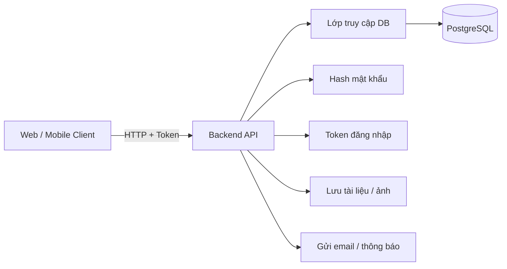

Nguyên tắc chung:

- Backend là nơi duy nhất truy cập database.
- Client không gửi `user_id` để quyết định danh tính; backend lấy từ token.
- Mọi truy vấn dùng tham số hóa.
- Mọi bảng nghiệp vụ có `id`, `created_at`, `updated_at`.
- Dùng UUID hoặc số tự tăng, miễn thống nhất toàn hệ thống.
- Local và production nên dùng cùng loại database.

### 2.1. Module kết nối database dùng chung

```text
src/db/index.js
```

Module này chịu trách nhiệm:

- Đọc `DATABASE_URL`.
- Tạo connection pool.
- Cung cấp `query(sql, params)`.
- Cung cấp `transaction(callback)`.
- Không để route tự tạo kết nối riêng.

Ví dụ:

```js
const { Pool } = require('pg');

const pool = new Pool({ connectionString: process.env.DATABASE_URL });

async function query(text, params) {
  return pool.query(text, params);
}

async function transaction(callback) {
  const client = await pool.connect();
  try {
    await client.query('BEGIN');
    const result = await callback(client);
    await client.query('COMMIT');
    return result;
  } catch (error) {
    await client.query('ROLLBACK');
    throw error;
  } finally {
    client.release();
  }
}

module.exports = { query, transaction, pool };
```

---

## 3. Mô hình dữ liệu

### 3.1. Bảng tài khoản trung tâm `users`

Mỗi người dùng là **một dòng** trong bảng `users`, dù là admin, gia sư, học sinh hay phụ huynh.

```sql
CREATE TABLE users (
    id UUID PRIMARY KEY DEFAULT gen_random_uuid(),
    full_name VARCHAR(255) NOT NULL,
    email VARCHAR(255) UNIQUE,
    phone VARCHAR(50) UNIQUE,
    password_hash VARCHAR(255),
    role VARCHAR(50) NOT NULL DEFAULT 'student',
    status VARCHAR(50) NOT NULL DEFAULT 'pending',
    is_blocked BOOLEAN NOT NULL DEFAULT false,
    avatar_url TEXT,
    created_at TIMESTAMP NOT NULL DEFAULT CURRENT_TIMESTAMP,
    updated_at TIMESTAMP NOT NULL DEFAULT CURRENT_TIMESTAMP,
    deleted_at TIMESTAMP
);
```

Vai trò đề xuất:

| Role | Ý nghĩa |
|---|---|
| `admin` | Quản trị viên trung tâm |
| `tutor` | Gia sư |
| `student` | Học sinh |
| `parent` | Phụ huynh |

Trạng thái đề xuất:

| Status | Ý nghĩa |
|---|---|
| `pending` | Mới đăng ký, chờ duyệt hoặc chờ kích hoạt |
| `active` | Đang hoạt động |
| `inactive` | Tạm nghỉ |
| `left` | Đã rời trung tâm |
| `rejected` | Hồ sơ bị từ chối |

Không nên dùng quá nhiều trạng thái rời rạc. Nếu cần, tách thành:

- `status`: trạng thái tài khoản.
- `is_blocked`: cờ khóa đăng nhập.
- `deleted_at`: xóa mềm.

### 3.2. Hồ sơ gia sư `tutor_profiles`

Không nên nhét toàn bộ thông tin gia sư vào bảng `users`, vì học sinh và phụ huynh không có các trường này.

```sql
CREATE TABLE tutor_profiles (
    user_id UUID PRIMARY KEY REFERENCES users(id) ON DELETE CASCADE,
    date_of_birth DATE,
    gender VARCHAR(50),
    address TEXT,
    bio TEXT,
    education VARCHAR(255),
    experience_years INTEGER NOT NULL DEFAULT 0,
    hourly_rate NUMERIC(12, 2) NOT NULL DEFAULT 0,
    teaching_mode VARCHAR(50) NOT NULL DEFAULT 'both',
    verification_status VARCHAR(50) NOT NULL DEFAULT 'pending',
    documents JSONB NOT NULL DEFAULT '[]'::jsonb,
    rating_avg NUMERIC(3, 2) NOT NULL DEFAULT 0,
    rating_count INTEGER NOT NULL DEFAULT 0,
    created_at TIMESTAMP NOT NULL DEFAULT CURRENT_TIMESTAMP,
    updated_at TIMESTAMP NOT NULL DEFAULT CURRENT_TIMESTAMP
);
```

`teaching_mode` có thể là:

- `online`
- `offline`
- `both`

`verification_status` có thể là:

- `pending`
- `verified`
- `rejected`

### 3.3. Hồ sơ học sinh `student_profiles`

```sql
CREATE TABLE student_profiles (
    user_id UUID PRIMARY KEY REFERENCES users(id) ON DELETE CASCADE,
    date_of_birth DATE,
    gender VARCHAR(50),
    grade_level VARCHAR(50),
    school VARCHAR(255),
    learning_goals TEXT,
    note TEXT,
    created_at TIMESTAMP NOT NULL DEFAULT CURRENT_TIMESTAMP,
    updated_at TIMESTAMP NOT NULL DEFAULT CURRENT_TIMESTAMP
);
```

### 3.4. Liên kết phụ huynh và học sinh `parent_students`

Một phụ huynh có thể có nhiều con. Một học sinh có thể có nhiều người liên hệ.

```sql
CREATE TABLE parent_students (
    id UUID PRIMARY KEY DEFAULT gen_random_uuid(),
    parent_id UUID NOT NULL REFERENCES users(id) ON DELETE CASCADE,
    student_id UUID NOT NULL REFERENCES users(id) ON DELETE CASCADE,
    relationship VARCHAR(50) NOT NULL DEFAULT 'parent',
    is_primary BOOLEAN NOT NULL DEFAULT false,
    created_at TIMESTAMP NOT NULL DEFAULT CURRENT_TIMESTAMP,
    UNIQUE(parent_id, student_id)
);
```

Điểm quan trọng:

- Phụ huynh chỉ được xem dữ liệu của học sinh có liên kết trong bảng này.
- Kiểm tra quyền này ở backend, không chỉ ẩn giao diện.

### 3.5. Môn học `subjects`

```sql
CREATE TABLE subjects (
    id UUID PRIMARY KEY DEFAULT gen_random_uuid(),
    name VARCHAR(100) NOT NULL UNIQUE,
    slug VARCHAR(100) NOT NULL UNIQUE,
    description TEXT,
    is_active BOOLEAN NOT NULL DEFAULT true,
    created_at TIMESTAMP NOT NULL DEFAULT CURRENT_TIMESTAMP
);
```

### 3.6. Gia sư dạy môn gì `tutor_subjects`

Quan hệ nhiều-nhiều giữa gia sư và môn học.

```sql
CREATE TABLE tutor_subjects (
    id UUID PRIMARY KEY DEFAULT gen_random_uuid(),
    tutor_id UUID NOT NULL REFERENCES users(id) ON DELETE CASCADE,
    subject_id UUID NOT NULL REFERENCES subjects(id) ON DELETE CASCADE,
    level VARCHAR(50),
    rate_override NUMERIC(12, 2),
    created_at TIMESTAMP NOT NULL DEFAULT CURRENT_TIMESTAMP,
    UNIQUE(tutor_id, subject_id, level)
);
```

`level` có thể là:

- `primary`
- `secondary`
- `high_school`
- `university`
- `adult`

### 3.7. Đơn đăng ký làm gia sư `tutor_applications`

Nếu cần lưu lịch sử duyệt hồ sơ và người duyệt.

```sql
CREATE TABLE tutor_applications (
    id UUID PRIMARY KEY DEFAULT gen_random_uuid(),
    user_id UUID NOT NULL REFERENCES users(id) ON DELETE CASCADE,
    subject_id UUID REFERENCES subjects(id),
    experience TEXT,
    documents JSONB NOT NULL DEFAULT '[]'::jsonb,
    status VARCHAR(50) NOT NULL DEFAULT 'pending',
    review_note TEXT,
    reviewed_by UUID REFERENCES users(id),
    reviewed_at TIMESTAMP,
    created_at TIMESTAMP NOT NULL DEFAULT CURRENT_TIMESTAMP
);
```

Trạng thái:

- `pending`
- `approved`
- `rejected`

Nếu nghiệp vụ đơn giản, có thể bỏ bảng này và dùng `users.status` + `tutor_profiles.verification_status`.

### 3.8. Lớp học `classes`

```sql
CREATE TABLE classes (
    id UUID PRIMARY KEY DEFAULT gen_random_uuid(),
    name VARCHAR(255) NOT NULL,
    subject_id UUID NOT NULL REFERENCES subjects(id),
    tutor_id UUID NOT NULL REFERENCES users(id),
    teaching_mode VARCHAR(50) NOT NULL DEFAULT 'offline',
    location VARCHAR(255),
    start_date DATE,
    end_date DATE,
    max_students INTEGER NOT NULL DEFAULT 1,
    fee_per_session NUMERIC(12, 2) NOT NULL DEFAULT 0,
    status VARCHAR(50) NOT NULL DEFAULT 'scheduled',
    created_by UUID REFERENCES users(id),
    created_at TIMESTAMP NOT NULL DEFAULT CURRENT_TIMESTAMP,
    updated_at TIMESTAMP NOT NULL DEFAULT CURRENT_TIMESTAMP
);
```

Trạng thái lớp:

- `scheduled`
- `ongoing`
- `completed`
- `cancelled`

### 3.9. Học sinh trong lớp `enrollments`

```sql
CREATE TABLE enrollments (
    id UUID PRIMARY KEY DEFAULT gen_random_uuid(),
    class_id UUID NOT NULL REFERENCES classes(id) ON DELETE CASCADE,
    student_id UUID NOT NULL REFERENCES users(id) ON DELETE CASCADE,
    status VARCHAR(50) NOT NULL DEFAULT 'active',
    joined_at TIMESTAMP NOT NULL DEFAULT CURRENT_TIMESTAMP,
    left_at TIMESTAMP,
    UNIQUE(class_id, student_id)
);
```

Trạng thái:

- `active`
- `paused`
- `left`

Ràng buộc `UNIQUE(class_id, student_id)` đảm bảo một học sinh không bị thêm hai lần vào cùng lớp.

### 3.10. Buổi học `class_sessions`

```sql
CREATE TABLE class_sessions (
    id UUID PRIMARY KEY DEFAULT gen_random_uuid(),
    class_id UUID NOT NULL REFERENCES classes(id) ON DELETE CASCADE,
    tutor_id UUID NOT NULL REFERENCES users(id),
    title VARCHAR(255),
    starts_at TIMESTAMP NOT NULL,
    ends_at TIMESTAMP NOT NULL,
    location VARCHAR(255),
    status VARCHAR(50) NOT NULL DEFAULT 'scheduled',
    checkin_code VARCHAR(20),
    qr_code VARCHAR(255),
    created_at TIMESTAMP NOT NULL DEFAULT CURRENT_TIMESTAMP
);
```

Trạng thái:

- `scheduled`
- `ongoing`
- `completed`
- `cancelled`

### 3.11. Điểm danh `attendances`

```sql
CREATE TABLE attendances (
    id UUID PRIMARY KEY DEFAULT gen_random_uuid(),
    session_id UUID NOT NULL REFERENCES class_sessions(id) ON DELETE CASCADE,
    student_id UUID NOT NULL REFERENCES users(id) ON DELETE CASCADE,
    status VARCHAR(50) NOT NULL DEFAULT 'present',
    note TEXT,
    checked_in_at TIMESTAMP,
    created_at TIMESTAMP NOT NULL DEFAULT CURRENT_TIMESTAMP,
    updated_at TIMESTAMP NOT NULL DEFAULT CURRENT_TIMESTAMP,
    UNIQUE(session_id, student_id)
);
```

Trạng thái điểm danh:

- `present`
- `absent`
- `late`
- `excused`

`UNIQUE(session_id, student_id)` đảm bảo mỗi học sinh chỉ có một bản ghi điểm danh cho mỗi buổi.

### 3.12. Học phí `invoices` và `payments`

Hóa đơn:

```sql
CREATE TABLE invoices (
    id UUID PRIMARY KEY DEFAULT gen_random_uuid(),
    student_id UUID NOT NULL REFERENCES users(id),
    class_id UUID REFERENCES classes(id),
    period_start DATE NOT NULL,
    period_end DATE NOT NULL,
    amount NUMERIC(12, 2) NOT NULL,
    due_date DATE,
    status VARCHAR(50) NOT NULL DEFAULT 'unpaid',
    created_at TIMESTAMP NOT NULL DEFAULT CURRENT_TIMESTAMP,
    updated_at TIMESTAMP NOT NULL DEFAULT CURRENT_TIMESTAMP
);
```

Trạng thái hóa đơn:

- `unpaid`
- `partial`
- `paid`
- `overdue`
- `cancelled`

Thanh toán:

```sql
CREATE TABLE payments (
    id UUID PRIMARY KEY DEFAULT gen_random_uuid(),
    invoice_id UUID NOT NULL REFERENCES invoices(id) ON DELETE CASCADE,
    amount NUMERIC(12, 2) NOT NULL,
    method VARCHAR(50) NOT NULL DEFAULT 'cash',
    paid_at TIMESTAMP NOT NULL DEFAULT CURRENT_TIMESTAMP,
    recorded_by UUID REFERENCES users(id),
    note TEXT
);
```

Quy tắc:

- Tổng `payments.amount` không vượt quá `invoices.amount`.
- Cập nhật `invoices.status` trong cùng transaction với lần thanh toán.
- Không xóa thanh toán; nếu sai thì tạo bút toán đảo hoặc đánh dấu hủy.

### 3.13. Đánh giá gia sư `tutor_reviews`

```sql
CREATE TABLE tutor_reviews (
    id UUID PRIMARY KEY DEFAULT gen_random_uuid(),
    class_id UUID NOT NULL REFERENCES classes(id) ON DELETE CASCADE,
    student_id UUID NOT NULL REFERENCES users(id),
    tutor_id UUID NOT NULL REFERENCES users(id),
    rating INTEGER NOT NULL CHECK (rating BETWEEN 1 AND 5),
    comment TEXT,
    created_at TIMESTAMP NOT NULL DEFAULT CURRENT_TIMESTAMP,
    UNIQUE(class_id, student_id)
);
```

Sau khi thêm đánh giá, cập nhật lại `tutor_profiles.rating_avg` và `rating_count` trong cùng transaction.

### 3.14. Nhật ký thao tác `audit_logs`

```sql
CREATE TABLE audit_logs (
    id UUID PRIMARY KEY DEFAULT gen_random_uuid(),
    actor_id UUID REFERENCES users(id),
    action VARCHAR(100) NOT NULL,
    target_type VARCHAR(50),
    target_id UUID,
    old_data JSONB,
    new_data JSONB,
    created_at TIMESTAMP NOT NULL DEFAULT CURRENT_TIMESTAMP
);
```

Dùng cho:

- Duyệt hoặc từ chối gia sư.
- Đổi vai trò.
- Khóa hoặc mở khóa tài khoản.
- Thêm hoặc xóa học sinh khỏi lớp.
- Sửa học phí.
- Hủy buổi học.

---

## 4. Vòng đời tài khoản

### 4.1. Gia sư

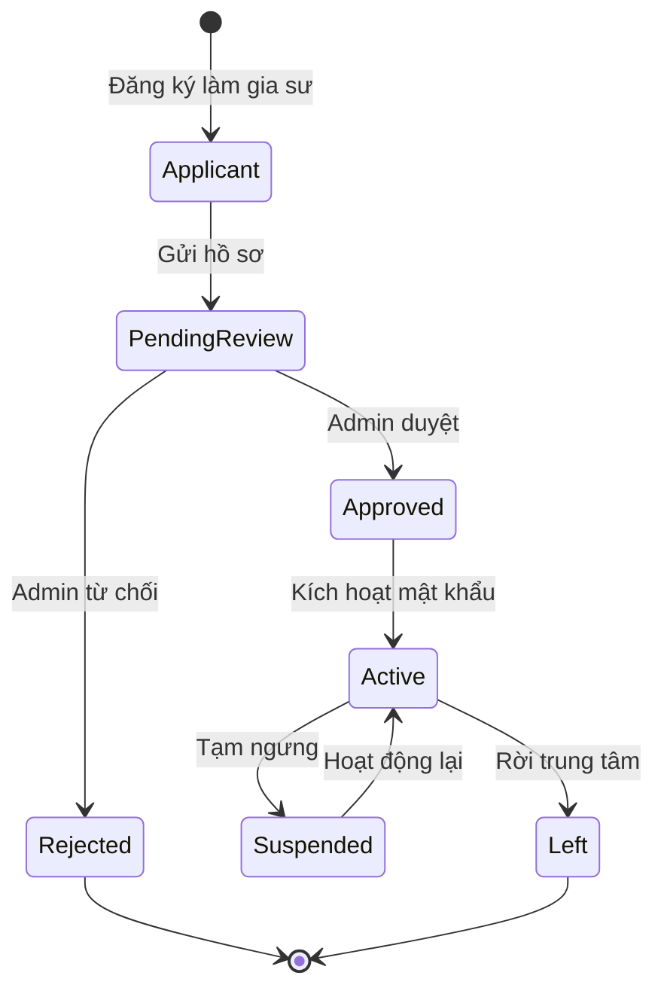

### 4.2. Học sinh

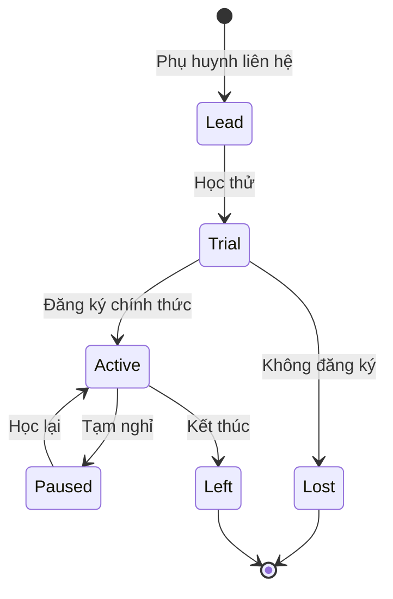

Ghi chú:

- Học sinh nhỏ tuổi có thể không cần tài khoản đăng nhập; phụ huynh quản lý.
- Nếu học sinh có tài khoản, vẫn cần liên kết với phụ huynh.
- Tài khoản gia sư chỉ được tạo sau khi hồ sơ được duyệt hoặc ở trạng thái chờ kích hoạt.

---

## 5. Luồng xử lý chi tiết

### 5.1. Gia sư đăng ký

```text
POST /api/tutors/register
```

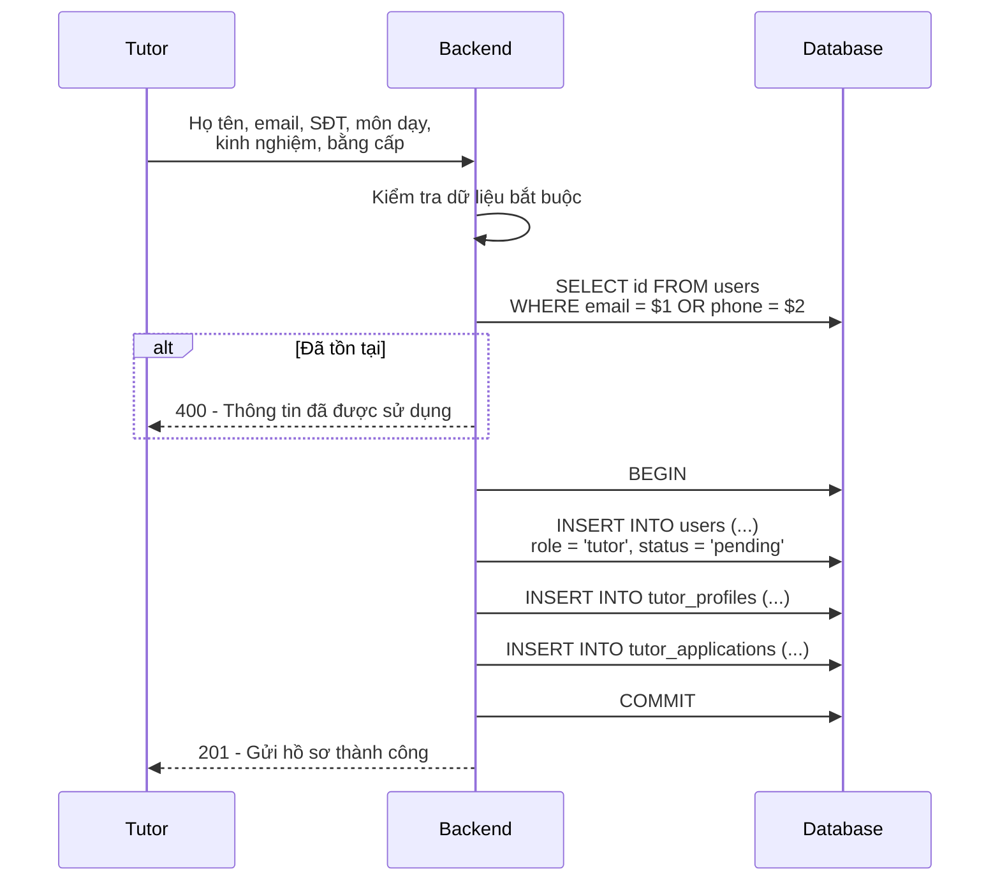

Điểm quan trọng:

- Dùng transaction vì tạo dữ liệu ở nhiều bảng.
- `password_hash` để NULL cho đến khi kích hoạt.
- Không trả về `password_hash`.
- Lưu tài liệu dưới dạng JSONB hoặc bảng riêng nếu cần quản lý file chi tiết.

### 5.2. Admin duyệt gia sư

```text
PUT /api/tutors/:id/approve
PUT /api/tutors/:id/reject
```

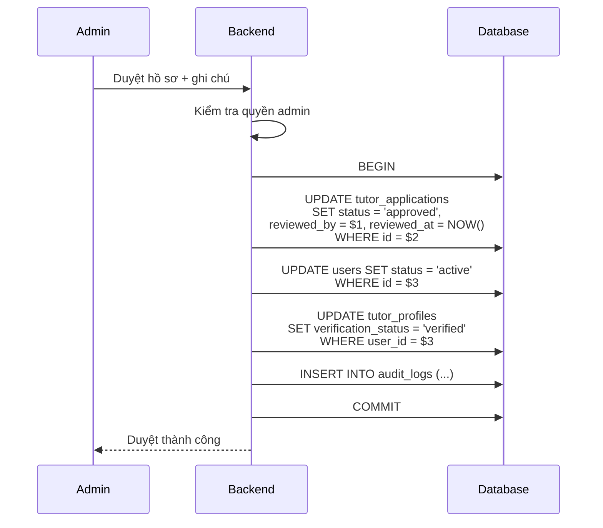

Nguyên tắc:

- Duyệt là cập nhật trạng thái, không tạo tài khoản mới.
- Chỉ duyệt hồ sơ đang ở trạng thái `pending`.
- Ghi lại người duyệt và thời điểm duyệt.
- Gửi email sau khi commit thành công.

### 5.3. Kích hoạt tài khoản

```text
POST /api/auth/activate
```

Hai cách phổ biến:

**Cách A: Gia sư tự đặt mật khẩu bằng mã xác thực**

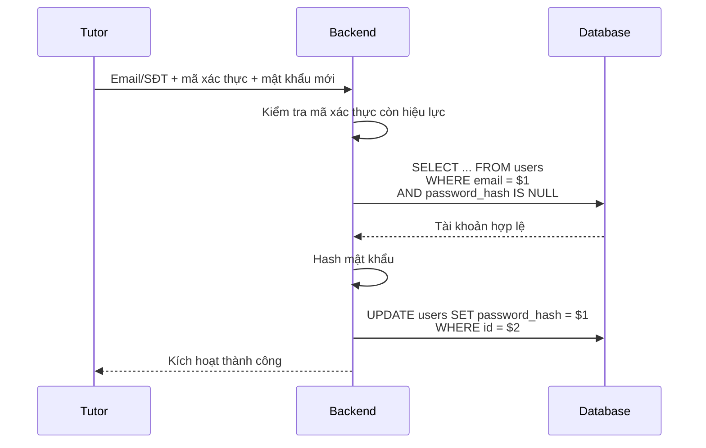

**Cách B: Gửi link kích hoạt qua email**

```sql
CREATE TABLE activation_tokens (
    id UUID PRIMARY KEY DEFAULT gen_random_uuid(),
    user_id UUID NOT NULL REFERENCES users(id) ON DELETE CASCADE,
    token_hash VARCHAR(255) NOT NULL,
    expires_at TIMESTAMP NOT NULL,
    used_at TIMESTAMP,
    created_at TIMESTAMP NOT NULL DEFAULT CURRENT_TIMESTAMP
);
```

Luồng:

1. Admin duyệt gia sư.
2. Backend tạo token ngẫu nhiên, lưu hash vào DB.
3. Gửi link chứa token cho gia sư.
4. Gia sư bấm link, đặt mật khẩu.
5. Backend kiểm tra token, cập nhật `password_hash`, đánh dấu token đã dùng.

Quy tắc:

- Chỉ tài khoản chưa có `password_hash` mới được kích hoạt.
- Token phải có thời hạn và chỉ dùng một lần.
- Không lưu token gốc, chỉ lưu hash.

### 5.4. Đăng nhập

```text
POST /api/auth/login
```

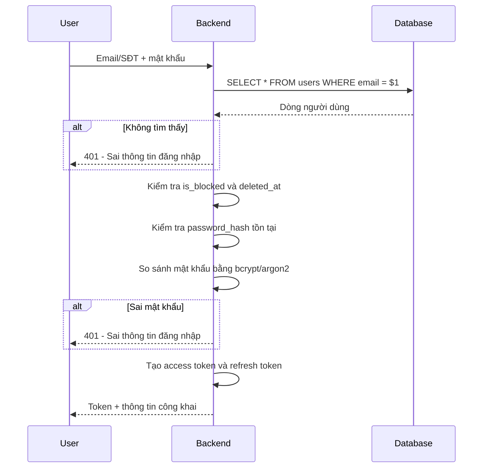

Sau khi đăng nhập:

- `admin`: quản lý toàn bộ.
- `tutor`: xem lớp được phân công, điểm danh, xem lịch.
- `student`: xem lớp, lịch học, điểm danh, học phí cá nhân.
- `parent`: xem dữ liệu của học sinh liên kết.

Quy tắc bảo mật:

- Không trả lời khác nhau giữa "sai email" và "sai mật khẩu".
- Không trả về `password_hash`.
- Kiểm tra quyền ở backend cho từng tài nguyên.
- Không tin `role`, `tutor_id`, `student_id` do client gửi lên.

### 5.5. Phân quyền theo tài nguyên

Kiểm tra quyền không chỉ dựa vào role mà còn dựa vào quan hệ dữ liệu.

Ví dụ: gia sư chỉ được điểm danh lớp mình phụ trách.

```sql
SELECT 1
FROM classes c
JOIN class_sessions s ON s.class_id = c.id
WHERE s.id = $1 AND c.tutor_id = $2;
```

Ví dụ: phụ huynh chỉ được xem học sinh của mình.

```sql
SELECT 1
FROM parent_students
WHERE parent_id = $1 AND student_id = $2;
```

Nếu không có kết quả, trả `403` hoặc `404` tùy chiến lược bảo mật.

### 5.6. Tạo tài khoản học sinh và liên kết phụ huynh

```text
POST /api/students
POST /api/students/:id/link-parent
```

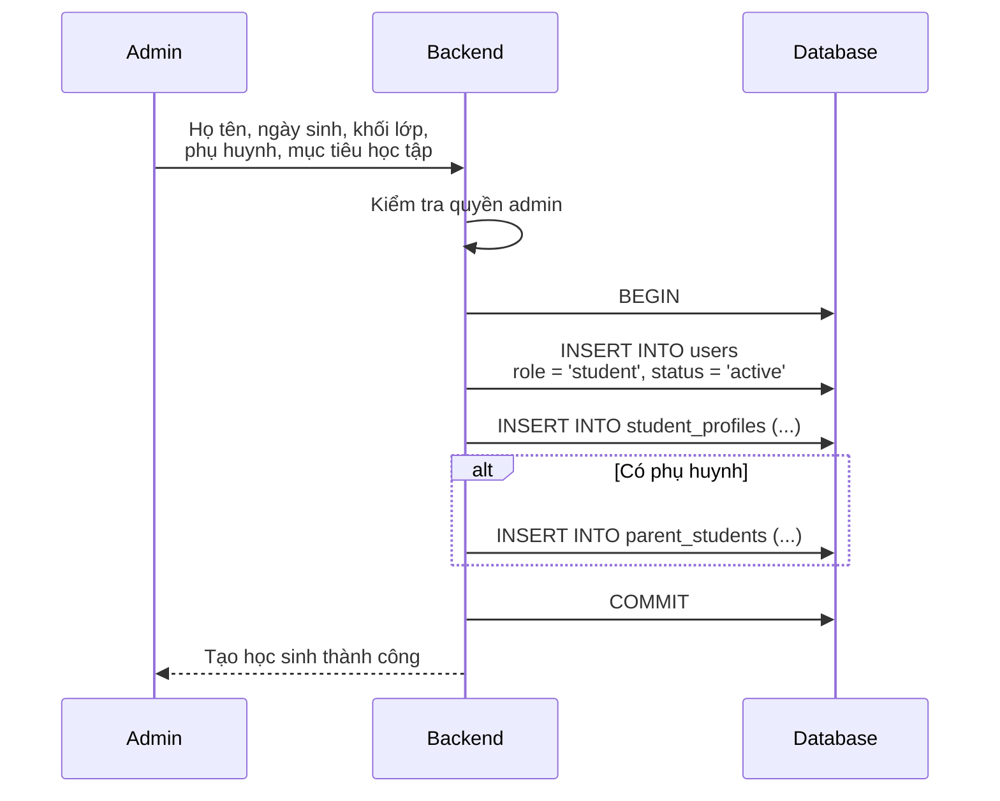

Trường hợp phụ huynh tự đăng ký cho con:

1. Phụ huynh tạo tài khoản `parent`.
2. Tạo hồ sơ học sinh.
3. Hệ thống liên kết `parent_students`.
4. Admin duyệt nếu cần.

### 5.7. Tạo lớp và phân công gia sư

```text
POST /api/classes
```

```sql
INSERT INTO classes (
    name, subject_id, tutor_id, teaching_mode,
    location, start_date, end_date,
    max_students, fee_per_session, status, created_by
)
VALUES ($1, $2, $3, $4, $5, $6, $7, $8, $9, 'scheduled', $10)
RETURNING *;
```

Kiểm tra trước khi tạo:

- Môn học tồn tại và đang hoạt động.
- Gia sư tồn tại, có role `tutor`, đang hoạt động.
- Gia sư có đăng ký dạy môn đó trong `tutor_subjects`.
- Không trùng lịch với lớp khác của cùng gia sư.

### 5.8. Thêm học sinh vào lớp

```text
POST /api/classes/:id/enroll
Body: { "student_ids": ["uuid1", "uuid2"] }
```

Đây là thao tác cần transaction và kiểm tra sức chứa.

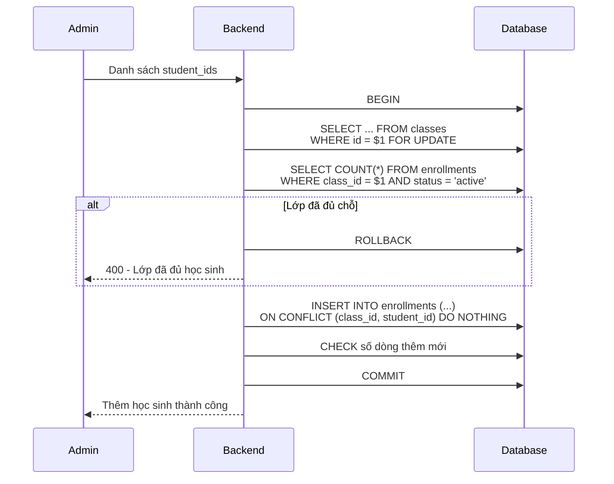

SQL mẫu:

```sql
INSERT INTO enrollments (class_id, student_id, status)
SELECT $1, unnest($2::uuid[]), 'active'
ON CONFLICT (class_id, student_id) DO NOTHING
RETURNING student_id;
```

Điểm quan trọng:

- Khóa dòng lớp bằng `FOR UPDATE` để tránh hai admin thêm vượt sức chứa cùng lúc.
- Dùng `ANY` hoặc `unnest` thay vì nối chuỗi `IN (...)`.
- Kiểm tra học sinh có tồn tại và đang hoạt động.
- Kiểm tra trùng lịch nếu hệ thống có quản lý lịch theo tuần.

### 5.9. Tạo buổi học

```text
POST /api/classes/:id/sessions
```

```sql
INSERT INTO class_sessions (
    class_id, tutor_id, title,
    starts_at, ends_at, location,
    status, checkin_code, qr_code
)
VALUES ($1, $2, $3, $4, $5, $6, 'scheduled', $7, $8)
RETURNING *;
```

Nên kiểm tra:

- `ends_at > starts_at`.
- Gia sư không có buổi khác trùng giờ.
- Lớp chưa kết thúc.
- Địa điểm hợp lệ nếu học offline.

### 5.10. Điểm danh

```text
POST /api/sessions/:id/check-in
Body: { "student_id": "uuid", "status": "present" }
```

```sql
INSERT INTO attendances (session_id, student_id, status, checked_in_at)
VALUES ($1, $2, $3, NOW())
ON CONFLICT (session_id, student_id)
DO UPDATE SET
    status = EXCLUDED.status,
    checked_in_at = NOW(),
    updated_at = NOW()
RETURNING *;
```

Quy tắc:

- Gia sư chỉ được điểm danh buổi thuộc lớp mình phụ trách.
- Học sinh chỉ được điểm danh nếu có trong lớp.
- Mỗi học sinh chỉ có một bản ghi cho mỗi buổi.
- Có thể cho học sinh tự quét mã QR, nhưng vẫn cần kiểm tra thời gian mở cổng điểm danh.

### 5.11. Thanh toán học phí

```text
POST /api/invoices
POST /api/invoices/:id/payments
```

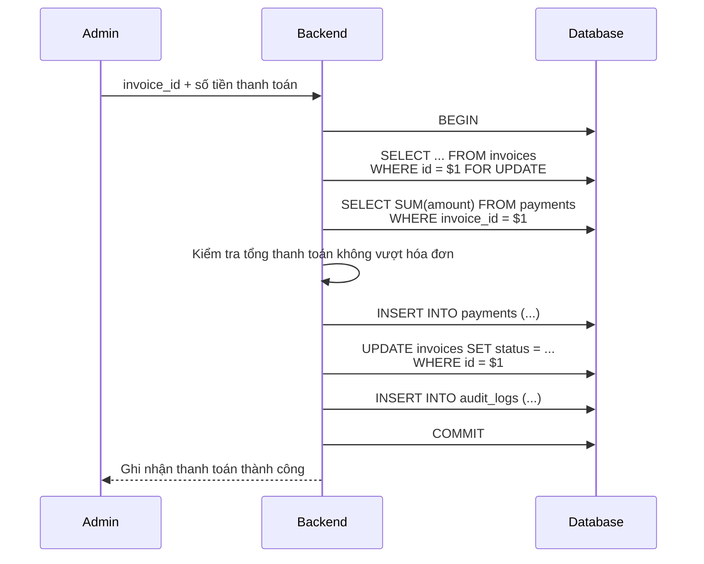

Quy tắc:

- Dùng transaction vì cập nhật hai bảng.
- Khóa hóa đơn bằng `FOR UPDATE` để tránh thanh toán đồng thời.
- Không xóa thanh toán đã ghi; nếu sai thì tạo bút toán điều chỉnh.
- Tính trạng thái hóa đơn dựa trên tổng đã thanh toán.

### 5.12. Đánh giá gia sư

```text
POST /api/classes/:id/reviews
Body: { "rating": 5, "comment": "..." }
```

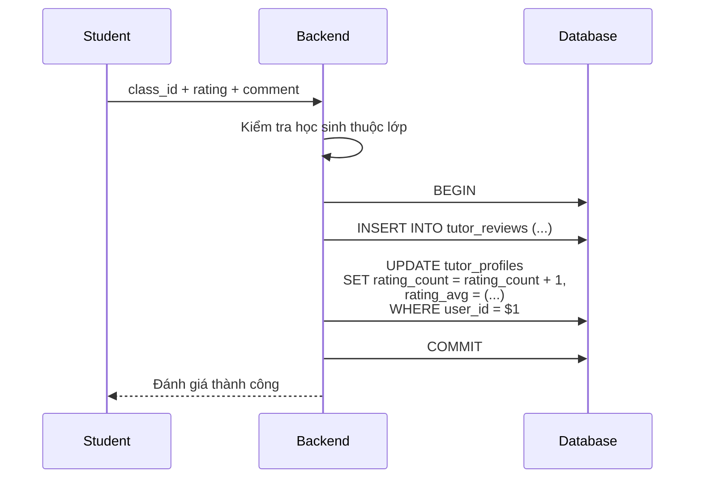

Quy tắc:

- Chỉ học sinh hoặc phụ huynh của học sinh trong lớp mới được đánh giá.
- Mỗi học sinh chỉ đánh giá một lần cho mỗi lớp.
- Chỉ đánh giá khi lớp đã kết thúc hoặc đã học đủ số buổi tối thiểu.
- Tính lại điểm trung bình trong cùng transaction.

### 5.13. Báo cáo và thống kê

Dùng aggregate thay vì tải toàn bộ dữ liệu:

```sql
-- Số gia sư đang hoạt động
SELECT COUNT(*) FROM users
WHERE role = 'tutor' AND status = 'active' AND deleted_at IS NULL;

-- Số học sinh đang học
SELECT COUNT(DISTINCT student_id) FROM enrollments
WHERE status = 'active';

-- Số buổi học trong tháng
SELECT COUNT(*) FROM class_sessions
WHERE starts_at >= date_trunc('month', NOW())
  AND starts_at < date_trunc('month', NOW()) + INTERVAL '1 month';

-- Tỷ lệ điểm danh của một lớp
SELECT
    COUNT(*) FILTER (WHERE a.status = 'present') AS present_count,
    COUNT(*) AS total_count
FROM attendances a
JOIN class_sessions s ON s.id = a.session_id
WHERE s.class_id = $1;

-- Công nợ
SELECT SUM(amount) FROM invoices
WHERE status IN ('unpaid', 'partial', 'overdue');
```

Với báo cáo phức tạp:

- Tạo bảng tổng hợp `statistics`.
- Cập nhật bằng trigger hoặc job định kỳ.
- Hoặc dùng materialized view.

---

## 6. Quản lý nhiều người cùng lúc

### 6.1. Nguyên tắc

Không tạo database riêng cho từng gia sư hoặc học sinh. Tất cả nằm trong bảng trung tâm, quản lý bằng truy vấn tập hợp.

- Một `SELECT` trả về danh sách.
- Một `UPDATE ... WHERE id = $` sửa một người.
- `COUNT`, `SUM`, `AVG` tính trên toàn bộ.
- `WHERE id = ANY($1)` cập nhật nhiều người.
- Transaction và `FOR UPDATE` bảo vệ nghiệp vụ nhiều bước.

### 6.2. Danh sách có phân trang

```text
GET /api/tutors?page=1&limit=20&search=...
GET /api/students?page=1&limit=20&search=...
```

```sql
SELECT id, full_name, email, phone, status, created_at
FROM users
WHERE role = 'tutor'
  AND deleted_at IS NULL
  AND ($1 = '' OR full_name ILIKE '%' || $1 || '%')
ORDER BY created_at DESC
LIMIT $2 OFFSET $3;
```

Không tải toàn bộ danh sách về client khi dữ liệu lớn.

### 6.3. Cập nhật hàng loạt

```text
PUT /api/users/bulk/status
Body: { "ids": ["uuid1", "uuid2"], "status": "inactive" }
```

```sql
UPDATE users
SET status = $1, updated_at = NOW()
WHERE id = ANY($2::uuid[])
  AND deleted_at IS NULL
RETURNING id, full_name, status;
```

```text
PUT /api/classes/:id/enroll
Body: { "student_ids": ["uuid1", "uuid2"] }
```

```sql
INSERT INTO enrollments (class_id, student_id, status)
SELECT $1, unnest($2::uuid[]), 'active'
ON CONFLICT (class_id, student_id) DO NOTHING
RETURNING student_id;
```

Quy tắc:

- Giới hạn số phần tử mỗi lần, ví dụ tối đa 500.
- Kiểm tra quyền trước khi cập nhật.
- Ghi audit log một lần cho cả lô.
- Trả về số dòng đã cập nhật thực tế.

### 6.4. Transaction cho nghiệp vụ nhiều người

Ví dụ: tạo buổi học và khởi tạo điểm danh cho toàn bộ học sinh trong lớp.

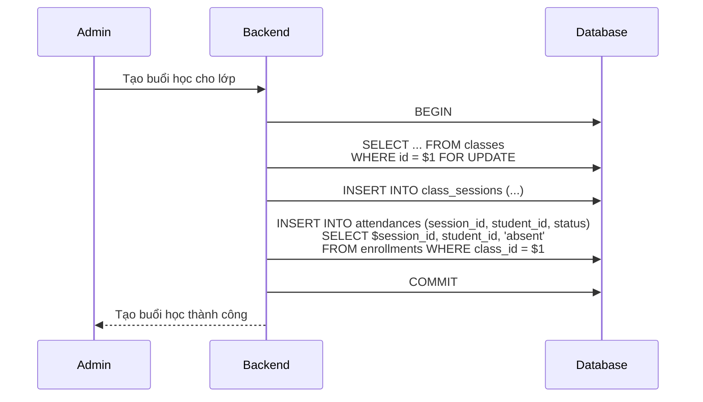

Lợi ích:

- Mọi học sinh đang học đều có dòng điểm danh mặc định.
- Gia sư chỉ cần cập nhật trạng thái, không phải thêm từng người.
- Nếu tạo buổi học lỗi, không có dữ liệu rác.

---

## 7. Nguyên tắc thiết kế

### 7.1. Một bảng tài khoản, nhiều bảng hồ sơ

```text
users
├── tutor_profiles
├── student_profiles
├── parent_students
├── tutor_subjects
├── tutor_applications
├── enrollments
├── attendances
├── invoices
├── payments
├── tutor_reviews
└── audit_logs
```

Ưu điểm:

- Đăng nhập chỉ đọc bảng `users`.
- Hồ sơ và nghiệp vụ mở rộng không làm bảng chính phình to.
- Dễ phân quyền theo vai trò.

### 7.2. Dùng khóa ngoại và ràng buộc

- `UNIQUE` cho email, số điện thoại.
- `UNIQUE(class_id, student_id)` cho đăng ký lớp.
- `UNIQUE(session_id, student_id)` cho điểm danh.
- `UNIQUE(class_id, student_id)` cho đánh giá.
- `CHECK` cho trạng thái, vai trò, rating.
- `ON DELETE CASCADE` cho dữ liệu phụ thuộc.
- `ON DELETE SET NULL` cho người duyệt, người tạo.

### 7.3. Xóa mềm

Dùng `deleted_at` cho người dùng và dữ liệu quan trọng.

```sql
UPDATE users SET deleted_at = NOW() WHERE id = $1;
```

Mọi truy vấn danh sách thêm:

```sql
WHERE deleted_at IS NULL
```

Chỉ xóa cứng khi dữ liệu thật sự không cần lưu vết.

### 7.4. Index

```sql
CREATE INDEX idx_users_role_status ON users(role, status);
CREATE INDEX idx_users_created_at ON users(created_at);
CREATE INDEX idx_enrollments_class ON enrollments(class_id);
CREATE INDEX idx_enrollments_student ON enrollments(student_id);
CREATE INDEX idx_sessions_class ON class_sessions(class_id);
CREATE INDEX idx_sessions_starts_at ON class_sessions(starts_at);
CREATE INDEX idx_attendances_session ON attendances(session_id);
CREATE INDEX idx_invoices_student ON invoices(student_id);
CREATE INDEX idx_invoices_status ON invoices(status);
```

Nếu tìm kiếm theo tên:

```sql
CREATE EXTENSION IF NOT EXISTS pg_trgm;
CREATE INDEX idx_users_full_name_trgm
ON users USING gin (full_name gin_trgm_ops);
```

### 7.5. Bảo mật

- Hash mật khẩu bằng bcrypt, scrypt hoặc argon2.
- Không lưu mật khẩu gốc hoặc token gốc.
- Dùng HTTPS.
- Giới hạn số lần đăng nhập sai.
- Kiểm tra quyền ở backend, không chỉ ẩn nút ở frontend.
- Phụ huynh chỉ xem dữ liệu của con mình.
- Gia sư chỉ xem lớp và học sinh mình phụ trách.
- Ghi audit log cho thao tác quản trị.
- Không trả về thông tin nhạy cảm trong lỗi.

---

## 8. Checklist áp dụng

### Bước 1: Xác định nghiệp vụ

- [ ] Hệ thống có những vai trò nào?
- [ ] Học sinh có tài khoản riêng hay phụ huynh quản lý?
- [ ] Một học sinh có thể học nhiều lớp, nhiều môn không?
- [ ] Một gia sư có thể dạy nhiều môn, nhiều lớp không?
- [ ] Có cần lưu lịch sử duyệt gia sư không?
- [ ] Có quản lý học phí và công nợ không?
- [ ] Có đánh giá gia sư không?

### Bước 2: Thiết kế bảng

- [ ] Tạo `users` với `id`, email, phone, `password_hash`, `role`, `status`.
- [ ] Tạo `tutor_profiles` và `student_profiles`.
- [ ] Tạo `parent_students` nếu có phụ huynh.
- [ ] Tạo `subjects` và `tutor_subjects`.
- [ ] Tạo `classes` và `enrollments`.
- [ ] Tạo `class_sessions` và `attendances`.
- [ ] Tạo `invoices` và `payments` nếu có học phí.
- [ ] Tạo `tutor_reviews` nếu có đánh giá.
- [ ] Tạo `audit_logs`.

### Bước 3: Xây dựng luồng

- [ ] Gia sư đăng ký và gửi hồ sơ.
- [ ] Admin duyệt hoặc từ chối.
- [ ] Gia sư kích hoạt tài khoản.
- [ ] Đăng nhập trả token.
- [ ] Middleware kiểm tra token và quyền.
- [ ] Admin tạo học sinh và liên kết phụ huynh.
- [ ] Admin tạo lớp và phân công gia sư.
- [ ] Admin thêm học sinh vào lớp.
- [ ] Tạo buổi học và điểm danh.
- [ ] Ghi nhận học phí.
- [ ] Đánh giá gia sư.
- [ ] Báo cáo, thống kê.

### Bước 4: Bảo vệ dữ liệu

- [ ] Hash mật khẩu.
- [ ] Kiểm tra quyền ở mọi route quản trị.
- [ ] Kiểm tra quan hệ phụ huynh - học sinh.
- [ ] Kiểm tra quan hệ gia sư - lớp.
- [ ] Kiểm tra `is_blocked` và `deleted_at`.
- [ ] Ghi audit log.
- [ ] Giới hạn kích thước request và số phần tử bulk.
- [ ] Thêm index cho cột thường lọc.

### Bước 5: Kiểm thử

- [ ] Đăng ký trùng email/số điện thoại.
- [ ] Duyệt hai lần cùng một hồ sơ.
- [ ] Kích hoạt lại tài khoản đã kích hoạt.
- [ ] Đăng nhập khi bị khóa.
- [ ] Phụ huynh xem học sinh không liên kết.
- [ ] Gia sư điểm danh lớp không phụ trách.
- [ ] Thêm học sinh vượt sức chứa lớp.
- [ ] Hai admin thêm học sinh cùng lúc.
- [ ] Thanh toán vượt số tiền hóa đơn.
- [ ] Đánh giá trùng cho cùng một lớp.
- [ ] Bulk update với danh sách rỗng hoặc id không tồn tại.

---

## 9. Đối chiếu với dự án SmashTeam

Tài liệu này kế thừa cách xử lý database của SmashTeam và chuyển sang nghiệp vụ gia sư - học sinh.

| SmashTeam | Dự án gia sư - học sinh |
|---|---|
| `users` | `users` |
| `candidate`, `member`, `admin` | `student`, `tutor`, `parent`, `admin` |
| `casting_slots` | `classes` |
| `sessions` | `class_sessions` |
| `attendances` | `attendances` |
| `matches` và ELO | `enrollments`, `invoices`, `tutor_reviews` |
| `elo_singles`, `elo_doubles` | `tutor_profiles.rating_avg`, `rating_count` |
| Duyệt ứng viên | Duyệt hồ sơ gia sư |
| Điểm danh buổi tập | Điểm danh buổi học |
| Transaction nhập trận đấu | Transaction thêm học sinh, thanh toán, đánh giá |

Các file SmashTeam có thể tham khảo:

| File | Vai trò |
|---|---|
| `backend/db/index.js` | Kết nối database |
| `backend/db/schema.sql` | Schema gốc |
| `backend/routes/auth.js` | Đăng nhập, kích hoạt |
| `backend/routes/users.js` | Đăng ký, duyệt, danh sách |
| `backend/routes/profile.js` | Hồ sơ, mật khẩu |
| `backend/routes/admin.js` | Quản trị, khóa, đổi quyền |
| `backend/routes/matches.js` | Transaction cập nhật nhiều người |
| `backend/middleware/auth.js` | Xác thực token và quyền |

---

## 10. Lỗi thường gặp

| Lỗi | Hậu quả | Cách tránh |
|---|---|---|
| Nhét mọi thông tin vào `users` | Bảng phình to, nhiều cột NULL | Tách `tutor_profiles`, `student_profiles` |
| Không có ràng buộc `UNIQUE` | Trùng email, trùng học sinh trong lớp | Thêm UNIQUE ở database |
| Lưu mật khẩu gốc | Rò rỉ tài khoản | Hash bằng bcrypt/argon2 |
| Tin `role` từ client | Leo thang quyền | Lấy quyền từ token hoặc DB |
| Không kiểm tra quan hệ phụ huynh | Phụ huynh xem dữ liệu người khác | Kiểm tra `parent_students` |
| Không kiểm tra quan hệ gia sư | Gia sư sửa lớp người khác | Kiểm tra `classes.tutor_id` |
| Thêm học sinh không transaction | Vượt sức chứa, dữ liệu lệch | `FOR UPDATE` + transaction |
| Thanh toán không transaction | Sai trạng thái hóa đơn | Khóa hóa đơn, tính lại tổng |
| Xóa cứng người dùng | Mất lịch sử lớp, học phí | Xóa mềm bằng `deleted_at` |
| Tải toàn bộ danh sách | Chậm khi dữ liệu lớn | Phân trang phía server |
| Không có audit log | Không biết ai đã thay đổi | Ghi log thao tác quản trị |

---

## 11. Tóm tắt

- Mỗi người dùng là một dòng trong bảng `users`, phân biệt bằng `role`.
- Gia sư và học sinh có bảng hồ sơ riêng.
- Gia sư đăng ký, admin duyệt, sau đó kích hoạt mật khẩu.
- Học sinh có thể do admin tạo hoặc phụ huynh tạo và liên kết.
- Lớp học liên kết gia sư, môn học và nhiều học sinh qua `enrollments`.
- Buổi học và điểm danh dùng bảng trung gian với ràng buộc `UNIQUE`.
- Học phí dùng `invoices` và `payments`, cập nhật trong transaction.
- Quản lý nhiều người bằng truy vấn tập hợp, phân trang, bulk update.
- Nghiệp vụ ảnh hưởng nhiều bảng dùng transaction và `FOR UPDATE`.
- Bảo mật nằm ở backend: hash mật khẩu, kiểm tra quyền, kiểm tra quan hệ, audit log.
